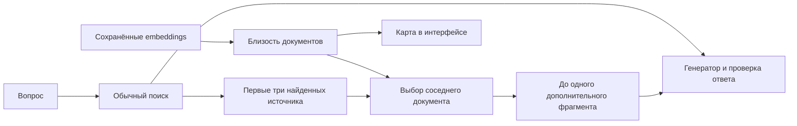

# Польза графа в текущей реализации «Фортуны»

Дата проверки: 12 октября 2026 года. Оценивалось текущее содержимое рабочей
директории, включая незакоммиченные изменения. Код приложения и рабочие индексы
не изменялись. Измерения использовали отдельные базы и собственный сервер
embeddings; рабочая SQLite читалась в режиме `mode=ro`, без выгрузки текстов
пользователя.

## Вывод

Смысловой граф технически оправдан как недорогой способ навигации и дополнения
слабого семантического поиска. На проверенном наборе он восстановил источники
двух вопросов, которые не восстановило простое увеличение semantic top-3 до
top-4. Однако **прироста полноты относительно стандартного hybrid-поиска не
обнаружено**: hybrid уже собрал обязательные доказательства всех 28 вопросов.
Автоматическое добавление соседа увеличило объём контекста примерно на 9,5%.

Это оценка поиска на небольшом синтетическом наборе. Она не доказывает ни
улучшение, ни ухудшение конечных ответов, а также не измеряет удобство карты для
пользователя. Развивать граф стоит под конкретные вопросы о связях и пробелах
поиска, с отдельным сравнением с сильным hybrid-поиском.

## Что реализовано

| Слой | Представление | Использование |
| --- | --- | --- |
| Текущая карта и автоматическое дополнение | Узлы-документы; ненаправленные линии косинусной близости | Среднее нормализованных embeddings фрагментов; порог 0,82; до трёх выбранных соседей на документ; один переход и максимум один дополнительный фрагмент |
| Граф извлечённых отношений | Сущности, типы отношений, направление, ID исходного фрагмента и цитата | LLM-извлечение при соответствующей индексации; специализированный GraphRAG и API совместимости |

Узел может иметь больше трёх линий за счёт входящих выборов соседей. Текущая
карта не показывает типы отношений, причинность, противоречия или доказанные
цепочки. Значение близости 0,82 не является вероятностью истинности.

Основной путь:



Положительные стороны реализации: переиспользование уже сохранённых векторов,
отсутствие новых модельных вызовов при построении и расширении графа, ограничение
контекста, разделение библиотеки и workspace, проверка свежести файлов и
возврат к обычным результатам при отказе графа. Текст читается из исходных
фрагментов; линия не выдаётся за доказательство факта.

Код: `api/semantic_graph.py:68`, `api/semantic_graph.py:209`,
`api/hybrid_context_extractor.py:291`, `api/workspace_vector_index.py:189`,
`api/graph_rag.py:49`. Описание карты: [graph-workbench.md](graph-workbench.md).

## Новый контролируемый замер

Создан набор из **29 документов, 36 фрагментов и 28 вопросов**: 16 русских и
12 английских. Вопросы включают 17 случаев с одним обязательным источником и
11 случаев с несколькими. Есть похожие документы о другой системе, другом
отделе или годе, цепочка «проект → устройство → производитель → город» и
документ с несколькими темами. Обязательные ID источников размечены до получения
embeddings. Вопросы и разметка не генерировались моделью.

Использованы установленная Nomic GGUF, реальные сохранённые векторы и
существующий код MMR/BM25/RRF. Настройки соответствуют обычному плану поиска:
MMR `k=6`, `fetch_k=16`, `lambda_mult=0.7`; RRF с лексическим весом **1,25**;
три источника в итоговом отборе. Сравнения top-4 дополнительно разрешают ещё
один источник. Query router, история, переписывание вопроса, генератор ответа
и verifier не запускались. Таким образом, это проверка слоя retrieval, а не
полной пользовательской цепочки. Лексический поиск файлов workspace отличается
от проверенного BM25-поиска библиотеки.

«Все доказательства» означает, что в контекст попали все обязательные
фрагменты вопроса. Recall — средняя по вопросам доля найденных обязательных
фрагментов. Последний столбец считает именно обязательные доказательства,
а не любую полезную тематическую информацию.

| Поиск | Все доказательства | Средний recall | Средний объём, символы | Доля обязательных фрагментов в отборе |
| --- | ---: | ---: | ---: | ---: |
| Semantic top-3 | 24/28 | 92,26% | 465 | 41,67% |
| Semantic top-3 + граф | **26/28** | **95,83%** | 531 | 39,58% |
| Semantic top-4 | 24/28 | 93,45% | 608 | 32,14% |
| Hybrid top-3, вес 1,25 | **28/28** | **100%** | **482** | **47,62%** |
| Hybrid top-3 + граф | 28/28 | 100% | 527 | 44,35% |
| Hybrid top-4 | 28/28 | 100% | 639 | 35,71% |

Граф помог semantic-поиску в вопросах о промышленном релизе и изготовителе
устройства проекта. Среди 11 вопросов с несколькими источниками полнота
выросла с 7/11 до 9/11. Для 17 вопросов с одним источником оба top-3 поиска
уже имели полные доказательства; граф новых обязательных доказательств не добавил.

Для semantic top-3 граф добавил 11 фрагментов: два закрыли пробелы разметки.
Для стандартного hybrid — восемь: ни один не добавил отсутствовавшее обязательное
доказательство. Это **не означает**, что остальные фрагменты бесполезны для
любого объяснения или что они вызвали неправильный ответ: такой эффект не измерялся.

Проверено и сравнение с одинаковым числом источников для каждого вопроса:
обычный поиск выдавал четыре фрагмента только в тех случаях, когда граф
действительно добавлял четвёртый; в остальных — три. Результат: semantic без
графа 24/28 против 26/28 с графом; hybrid 28/28 в обоих вариантах. Посимвольный
и токенный бюджеты при этом не выравнивались.

Начальное построение графа из 29 документов заняло **24,8 мс**, получено
25 линий. Медианное время расширения после построения — **1,68 мс** для
semantic и **1,64 мс** для hybrid. Создание embeddings 64 текстов заняло
4,36 с, запуск собственного сервера — 3,09 с; эти времена исключены из времени
графа. Векторы вопросов кешировались для одинакового сравнения вариантов.
Задержки на большом корпусе и p95 этим замером не установлены.

Начальный исследовательский прогон с весом BM25 1,0 дал hybrid 27/28 без графа
и 28/28 с графом. После сверки с `RetrievalPlan.lexical_weight=1.25` выполнен
финальный прогон выше. Для оценки стандартного поведения используется только он:
настройка обычного поиска существенно влияет на вывод о пользе графа.

## Чувствительность порога и языка

Повтор существующего `tests/benchmark_semantic_graph.py` дал:

| Пара коротких документов | Косинусная близость | Связь при 0,82 |
| --- | ---: | --- |
| Русские тексты о backup/recovery | 0,8741 | Да |
| Русский текст о backup и рецепт | 0,7158 | Нет |
| Английские тексты о backup/recovery | 0,7637 | Нет |
| Английский текст о backup и рецепт | 0,4039 | Нет |

Порог пропускает английскую тематическую пару. В новом наборе при 0,82
ни один из 12 английских вопросов не получил дополнительного источника;
это не мешало обычному поиску собрать полные доказательства всех этих вопросов.
Такая маленькая выборка не доказывает общую непригодность модели для английского.

| Порог | Semantic: добавления / добавления с новыми доказательствами | Semantic: все доказательства | Hybrid: добавления / добавления с новыми доказательствами |
| --- | ---: | ---: | ---: |
| 0,76 | 17 / 2 | 26/28 | 21 / 0 |
| 0,82 | 11 / 2 | 26/28 | 8 / 0 |
| 0,86 | 7 / 1 | 25/28 | 5 / 0 |

На этом наборе снижение порога до 0,76 добавило контекст без нового прироста
полноты, а повышение до 0,86 потеряло один полезный semantic-переход. Это
анализ чувствительности, а не выбор нового оптимального порога: нужен отдельный
набор для настройки и проверки.

## Состояние рабочей dev-базы

Прочитаны только агрегаты SQLite, без экспорта содержимого документов:

- В библиотеке семь документов, 27 сущностей и 51 отношение. Все отношения
  относятся к одному документу; у всех 51 пустое поле `evidence`. Они имеют
  chunk ID, но их происхождение и смысл не проверялись повторно. Новые правила
  извлечения не переписывают старый граф без переиндексации.
- В workspace сохранены 26 свежих векторных индексов по равенству сохранённых
  хешей. Одна область полностью покрыта: 18 из 18 читаемых файлов. Другая —
  восемь из 339; ещё три области со списками файлов — без векторных индексов.
  Текущие файлы для этой статистики заново не читались. Общее число записей
  файлов включает неподдерживаемые типы и не является корректным знаменателем
  процента покрытия документов.
- Workspace-граф содержит 28 сущностей и 23 отношения; пустых цитат у них нет.
  Наличие цитаты само по себе не подтверждает трактовку отношения.
- В журнале найдено 18 завершённых `SEARCH_WORKSPACE` с сохранённым
  `graph_source_count`; в 17 добавлялся источник через смысловой граф. Это
  подтверждает использование механизма, но не влияние на ответ и не выигрыш.
  Остальные действия не имеют сопоставимого счётчика; их нельзя считать
  запросами с нулевым использованием графа.

Данные установленного desktop из AppData и содержимое рабочего Chroma
не инспектировались. Эти числа характеризуют только dev-базу.

## Ограничения, влияющие на полезность

1. **Дополнительный фрагмент не оценивается относительно вопроса.**
   `SemanticDocumentGraph.expand` ранжирует его по близости к исходному
   фрагменту. Это помогает с соседней темой, но допускает другой год, объект
   или процедуру, которые не отвечают на вопрос. Отбор нового доказательства
   и отбор похожего текста — разные задачи.
2. **В лексическом поиске workspace якорь может быть первым фрагментом файла.**
   При отсутствии chunk ID используется первый фрагмент файла в выборке
   хранилища — `chunks[ids[0]]`
   (`api/semantic_graph.py:225`). Для вопроса о середине длинного документа
   этот фрагмент может описывать другую тему. В новом замере этот путь
   не использовался; риск установлен по коду, а не по частоте пользовательских ошибок.
3. **При фиксированном бюджете workspace сосед сокращает тексты прямых результатов.**
   После расширения бюджет делится между всеми выбранными файлами
   (`api/workspace.py:1343`, `api/workspace.py:1348`). Например, при 12 000
   символах три файла получают по 4000, а четыре — по 3000. ID прямых результатов
   сохраняются, но объём каждого текста может уменьшиться. Потеря нужного
   доказательства на этом пути ещё не измерена.
4. **Карта близости не обеспечивает произвольные многошаговые ответы.**
   Расширение ограничено одним переходом. В синтетической цепочке связь
   «устройство — производитель» дала 0,8635, а «производитель — город» —
   0,7771 и не попала в карту. Обычный hybrid при этом нашёл все три источника:
   отсутствие линии не означает отсутствие ответа в корпусе.
5. **Ограничение масштаба и усреднение документов.**
   Рассматриваются первые 1000 документов области и до 20 000 фрагментов;
   строится матрица всех пар документов. Карта возвращает до 200 узлов по
   умолчанию, максимум 500. Усреднение разных тем может скрывать узкую связь;
   на нашем многотемном документе связь сохранилась, поэтому конкретный
   отказ из-за усреднения этим прогоном не подтверждён.
6. **Цитата в графе сущностей подтверждает происхождение, но не отношение.**
   `_evidence_chunk` проверяет дословное наличие текста. Отдельный смысловой
   аудит всех рёбер отсутствует. Старый реальный замер выявил ошибочный объект
   отношения `STORES`, несмотря на корректную цитату; см.
   [rag-benchmark-2026-10-06.md](rag-benchmark-2026-10-06.md).

## Что показывают исследования

**Глобальные обзоры большого корпуса.** В работе Microsoft GraphRAG на
корпусах порядка миллиона токенов выигрывал у vector RAG по полноте в
72–83% парных оценок. Это доля предпочтений LLM-судьи для обзорных вопросов,
а не прирост точности на 72–83%. Используются сущности, сообщества,
предварительные обзоры сообществ и объединение частичных ответов. Текущая
карта «Фортуны» этих этапов не реализует, поэтому цифры напрямую не переносимы.
[From Local to Global](https://arxiv.org/html/2404.16130).

**Фактические и многошаговые вопросы.** В текущей версии систематического
сравнения на Llama 3.1 8B получены следующие F1:

| Метод | Natural Questions: один шаг | HotpotQA: несколько шагов |
| --- | ---: | ---: |
| Обычный RAG | **64,78** | 60,04 |
| Community GraphRAG Local | 63,01 | 61,66 |
| HippoRAG2 | 61,03 | **63,01** |

Для HotpotQA выигрыш HippoRAG2 составил 2,97 процентного пункта; для
Natural Questions обычный RAG оказался лучше. Следовательно, преимущество
зависит от типа вопроса и реализации.
[RAG vs. GraphRAG: A Systematic Evaluation and Key Insights](https://arxiv.org/html/2502.11371).

**Сравнение с RAG, имеющим reranker.** В GraphRAG-Bench на корпусе романов
accuracy извлечения фактов: RAG с reranker 60,92, HippoRAG2 60,14. Для сложного
рассуждения: 42,93 против 53,38, то есть +10,45 процентного пункта в пользу
HippoRAG2. Это пример значимого выигрыша для связных задач и его отсутствия
для простых фактов. Корпуса, генератор и метод оценки отличаются от нашего
локального приложения.
[When to use Graphs in RAG](https://arxiv.org/html/2506.05690).

Совместный вывод из источников: граф особенно интересен, когда нужные сведения
разнесены между источниками и простой отбор по вопросу их не собирает.
Сравнивать следует с hybrid и reranking, с одинаковыми бюджетами и отдельными
классами вопросов. Одного количества линий или наличия цитаты для оценки
полезности недостаточно.

## Рекомендуемые следующие шаги

1. Сохранить карту и ограничения области. Не считать визуализацию измеренным
   улучшением ответов: навигационную пользу проверять отдельно по времени
   нахождения нужного документа пользователем.
2. Проверять кандидата относительно вопроса и того, какие доказательства уже
   найдены. Для workspace сохранять ID релевантного исходного фрагмента вместо
   выбора первого; учитывать его добавление при распределении бюджета.
3. Калибровать порог на размеченных тематических парах реального корпуса,
   отдельно проверяя языки, похожие версии и разные сущности. Автоматически
   снижать общий порог по четырём парам этого замера оснований нет.
4. Перед развитием графа сущностей провести отдельную оценку направления,
   субъекта, объекта и модальности отношений. Переиндексация старого графа
   библиотеки восстановит новый контракт цитат, но не заменит смысловую проверку.
5. Для решения о включении расширения по умолчанию подготовить хотя бы
   100 размеченных вопросов пользователя с простыми фактами, несколькими
   источниками, отсутствующими сведениями и обзорами. Сравнить hybrid,
   hybrid с reranking и hybrid с графом при одинаковом токенном бюджете.
   Оценивать итоговые факты, полноту ответа, ошибки атрибуции, задержку и
   стоимость индексации. Порог принятия изменения задать до прогона.

## Воспроизведение и проверки

Исследовательские скрипты и исходные JSON находятся в игнорируемой
`.user-evaluation/graph-usefulness-20261012/`. Они не являются изменением
поведения приложения. Финальный прогон:
`run-20261012-233735/result.json`; разметка — `fixture.json`; векторы —
`embeddings.npy`; агрегаты рабочей базы — `live-stats.json` в каталоге оценки.
`paired-analysis.json` содержит сравнение с одинаковым числом источников.

```powershell
.venv\Scripts\python.exe .user-evaluation/graph-usefulness-20261012/evaluate.py
.venv\Scripts\python.exe .user-evaluation/graph-usefulness-20261012/inspect_live_stats.py
.venv\Scripts\python.exe tests/benchmark_semantic_graph.py
.venv\Scripts\python.exe -m unittest discover -s tests -p test_semantic_graph.py -v
.venv\Scripts\python.exe -m unittest discover -s tests -p test_graph_workbench.py -v
.venv\Scripts\python.exe -m unittest discover -s tests -p test_rag_optimizations.py -k Graph -v
```

Пройдено 18 тестов смыслового графа, 15 тестов workbench и семь тестов
происхождения/переиспользования графа — **40/40**. Повтор существующего benchmark
также завершился успешно. Набор содержит SHA-256 разметки и ключевых файлов
кода; для воспроизведения важны установленная Nomic GGUF и версия runtime.
Полная генерация и проверка ответов, browser E2E карты, A/B на реальных текстах,
корпуса на предельных размерах и desktop в этой проверке не запускались.
